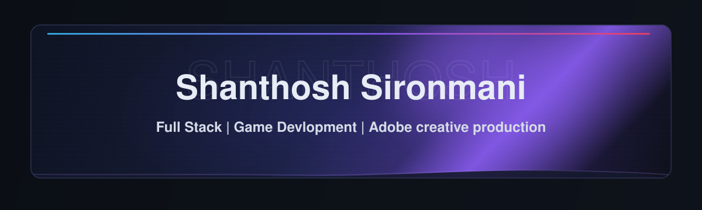

  

  

  
  
  
  
  

  
  

  

<h2 align="center">About me</h2>

  I’m Shanthosh Sironmani, COO at Altivora Hosting. I build web applications, work on the infrastructure behind them, and help troubleshoot service issues. I also develop FiveM gameplay systems and edit trailers and gameplay showcases.

  
  
  
  
  

  

<h2 align="center">Altivora Hosting</h2>

  At Altivora, my work covers the public hosting site, the tools we use to manage services, and the day-to-day operation of those services.

  
  
  
  
  
  
  
  

- **Web applications:** Build customer-facing pages and admin workflows. I work across the interface, application logic, and database so changes make sense at each layer.
- **Deployment and routing:** Run services on Linux, deploy with Docker, and use Cloudflare and `cloudflared` for routing and access. I also work with Pterodactyl to manage game server environments.
- **Technical support:** Trace runtime and MySQL connectivity problems, isolate where a failure starts, and document what to check when it happens again.

  
  

  

<h2 align="center">Vagos Roleplay</h2>

  I’ve worked on the Lua and ESX systems that run Vagos Roleplay, from how players join the server to what staff can see when they investigate an incident.

  
  
  
  
  
  
  

- **Combat and PvP:** Work on damage, headshots, and death handling, as well as free-for-all and PvP rules.
- **Player interactions:** Build carry interactions, job restrictions, and outfit and appearance logic.
- **Access and moderation:** Work on whitelist access and roleplay rules. Send gameplay events to Discord so staff can review what happened.
- **Rollout:** Help plan community updates and decide how new gameplay features fit the server’s rules.

  

  

<h2 align="center">Creative production</h2>

I edit trailers, montages, and technical showcases. For gameplay footage, I use Rockstar Editor to set up the shots, then cut the sequence in Premiere Pro. I use After Effects for motion work and Voukoder for exports.

In a trailer I cut for pacing and atmosphere. In a technical showcase I keep the sequence clear enough to follow the feature from input to result.

  
  
  
  
  
  
  
  

  

<h2 align="center">Tools I use</h2>

  A reference for the tools I use across web applications, infrastructure, and game servers.

### Web and application development

  

  
  
  
  
  
  
  
  
  
  

### Infrastructure and operations

  

  
  
  
  
  
  
  
  
  
  
  

### FiveM development

  
  

  

<h2 align="center">Project links</h2>

  
  

